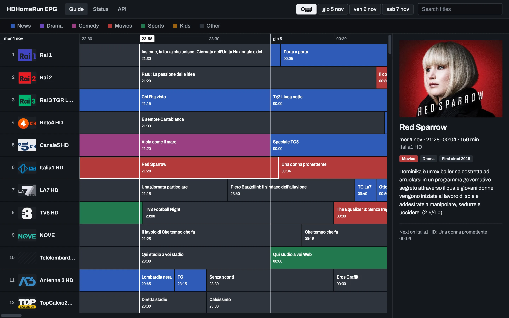
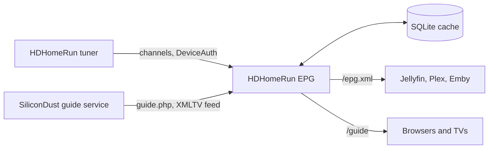
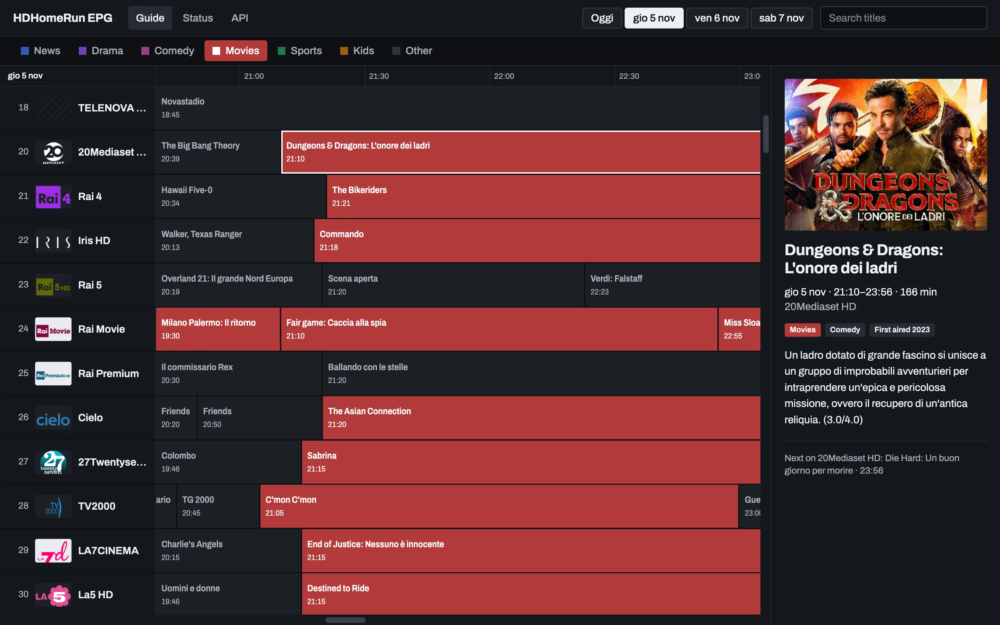
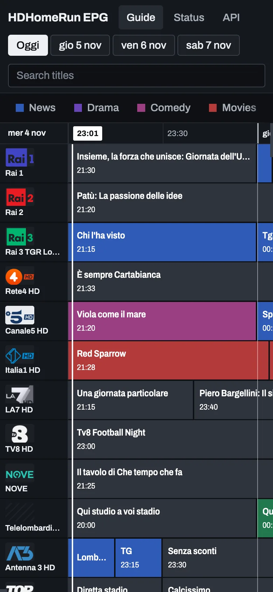
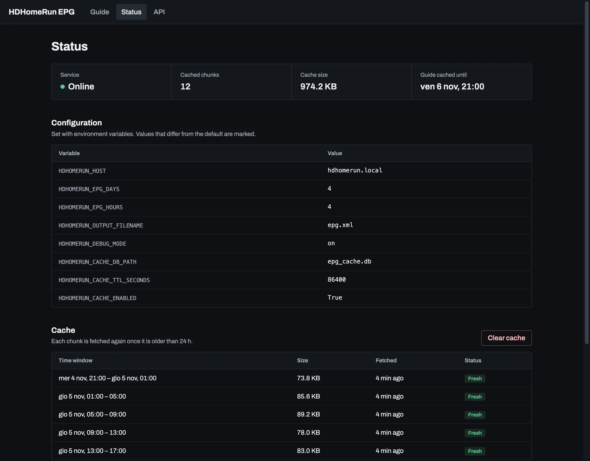

# HDHomeRun EPG

[](https://github.com/thekoma/HDHomeRunEPG-to-XmlTv/actions/workflows/test.yml)
[](https://github.com/thekoma/HDHomeRunEPG-to-XmlTv/releases/latest)
[](requirements.txt)
[](LICENSE)

HDHomeRun EPG runs next to an HDHomeRun tuner on your network. It turns the tuner's guide data into an XMLTV file for Jellyfin, Plex or Emby, and it serves a TV guide that you can browse from a phone, a laptop or the TV's own browser.



## How it works



The service asks the tuner for its channel list and its `DeviceAuth` key. With that key it downloads the schedule from SiliconDust's guide service (`guide.php`) in 4-hour chunks and keeps each chunk in a SQLite cache for a day. Every 20 to 28 hours, as SiliconDust asks, it also downloads SiliconDust's own XMLTV feed and adds the descriptions, categories, language and programme ids that the schedule leaves out. `/epg.xml` and `/guide` read from the same cache.

Without a DVR subscription, SiliconDust's guide covers about two days ahead. With one it covers more, and `HDHOMERUN_EPG_DAYS` sets how far the service goes.

## The TV guide

Open `http://<host>:8000/guide`. A programme's width is its length and its colour is its genre, so you can read the evening before you read a title. The white line is the current time.

- Pick a genre in the legend to dim everything else.
- Search by title to jump to the next showing.
- Move through the days with the buttons in the top bar.
- On a TV browser the page scales up, and the arrow keys and Enter work like a remote.



On a phone the channel column narrows and a programme's details slide up from the bottom.

<p>
  
  
</p>

## The XMLTV feed

`http://<host>:8000/epg.xml` is a standard XMLTV file, and it validates against the XMLTV DTD. Each channel has its name, its number and its logo. The channel ids are the tuner's channel numbers (for example `5.1` or `21`), so a media server can match them to the tuner's channels.

Each programme carries what the guide has for it:

- title, episode title and description
- categories from both of SiliconDust's sources
- original air date, and whether it is a first showing or a repeat
- episode number as shown on screen (`S09E18`), in `xmltv_ns` form and as a Schedules Direct `dd_progid`
- language, star rating, HD quality, image and poster

## Run it

### Docker

```bash
docker run -d --name hdhomerun-epg -p 8000:8000 \
  -e HDHOMERUN_HOST=192.168.1.100 \
  -v hdhomerun-epg-cache:/data \
  ghcr.io/thekoma/hdhomerunepgxml:latest
```

The image keeps its cache in `/data`, and the volume keeps the cache across restarts. The published images are for amd64. On an ARM machine, such as a Raspberry Pi, build the image from this repository with `docker compose up --build -d`.

### Kubernetes

[DEPLOY.md](DEPLOY.md) has Helm, Argo CD and Flux examples based on the bjw-s app-template chart.

### Connect your media server

Add an XMLTV guide source in Jellyfin, Plex or Emby with the URL `http://<host>:8000/epg.xml`.

The service has no authentication. Keep it on your network, or put it behind a proxy that checks who is asking.

## Configuration

| Variable | Default | What it does |
| --- | --- | --- |
| `HDHOMERUN_HOST` | `hdhomerun.local` | Address of the tuner. |
| `HDHOMERUN_EPG_DAYS` | `4` | How many days ahead to fetch at most. The free guide ends after about two days. |
| `HDHOMERUN_EPG_HOURS` | `4` | Hours per request to `guide.php`. Each response covers 4 hours, so a higher value leaves gaps. |
| `HDHOMERUN_CACHE_ENABLED` | `True` | Set to `False` to fetch the whole guide on every request. SiliconDust's XMLTV feed needs the cache, so it is skipped. |
| `HDHOMERUN_CACHE_DB_PATH` | `epg_cache.db`, `/data/epg_cache.db` in the image | Path of the SQLite cache. |
| `HDHOMERUN_CACHE_TTL_SECONDS` | `86400` | How long a cached chunk stays fresh. |
| `HDHOMERUN_DEBUG_MODE` | `on` | `on` logs the library at debug level; any other value logs at info level. |
| `HDHOMERUN_OUTPUT_FILENAME` | `epg.xml` | Used only by the library's `write_to_file`. The service does not write a file. |

## Status page and API



`http://<host>:8000/` shows whether the service is up, the configuration with the values that differ from the defaults marked, and every cached chunk with its age. The Clear cache button empties the cache.

| Method | Path | Returns |
| --- | --- | --- |
| `GET` | `/` | The status page, or the status as JSON when the request accepts `application/json` |
| `GET` | `/guide` | The TV guide |
| `GET` | `/epg.xml` | The XMLTV feed |
| `GET` | `/cache` | The cached chunks as JSON |
| `DELETE` | `/cache` | Empties the cache |
| `GET` | `/healthcheck` | `{"status": "ok"}` |
| `GET` | `/docs` | The OpenAPI documentation |

## Development

Run these from the repository root:

```bash
pip install -r requirements.txt
uvicorn app.main:app --reload
pytest
```

`pre-commit install` adds the ruff and pytest hooks from `.pre-commit-config.yaml`. CI runs the tests on Python 3.9, 3.10, 3.11 and 3.12, and ruff at the version the pre-commit file pins.

## Credits

This project started as a fork of [HDHomeRunEPG-to-XmlTv](https://github.com/IncubusVictim/HDHomeRunEPG-to-XmlTv) by @IncubusVictim, whose reverse engineering of the guide service it still builds on.

HDHomeRun is a SiliconDust product. This project is not affiliated with SiliconDust. It is released under the [MIT licence](LICENSE).
